<div align="center">

# VICUS

### Where tokenized assets become usable.

**Discover what exists. Understand what it represents. See what you can actually do — and prove what you did.**

A Stellar-first operating layer for navigating and using tokenized assets across supported networks — not another token directory or portfolio dashboard.

[](https://explorevicus.vercel.app)
[](https://youtu.be/w-jVztqD7qU)
[](#proof-on-stellar)

    

[Live app](https://explorevicus.vercel.app/) · [Demo](https://youtu.be/w-jVztqD7qU) · [Walkthrough](#judge-vicus-in-90-seconds) · [Stellar proof](#proof-on-stellar) · [Architecture](#architecture) · [Roadmap](docs/VICUS_MASTER_ROADMAP.md)

</div>

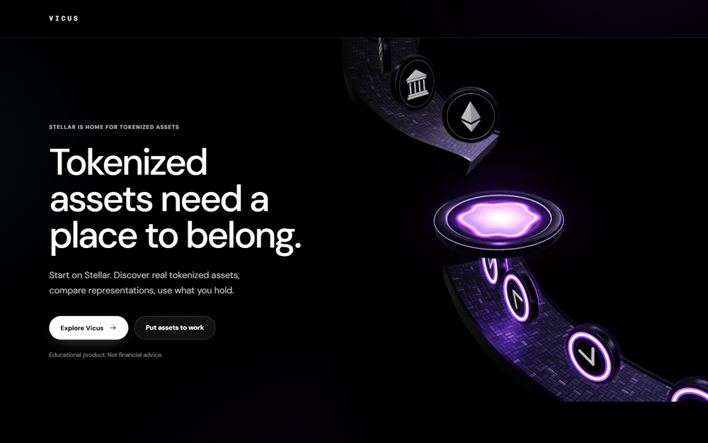

*Live hero motion from the production landing page.*

<div align="center">

**Journey:** Discover → Understand → Access → Hold → Use → Send → Earn → Exit. Stellar is home; connected ecosystems extend discovery and utility.

</div>

## Why Vicus exists

A tokenized asset can be technically real and practically unusable. The same company (say, Apple) appears as different products on different chains, from different issuers, with different eligibility rules — and existing interfaces never tell a normal person three things together: *what exists, what it is, and what I can actually do with it.*

- **Discoverability is fragmented.** Assets scatter across chains, issuers, and apps with no shared catalogue.
- **Issuer and eligibility restrictions hide in fine print.** Permissioned assets, jurisdictional exclusions, and trustline requirements surface only after you've committed.
- **Available actions are unclear.** Wallets move value but don't explain; dashboards display tokens but don't act.
- **Utility and portfolio live apart.** Swaps happen in one app, holdings in another, history nowhere.
- **Execution evidence is missing.** Quotes pose as results; "completed" often means "submitted."

Vicus brings these together: one catalogue for what exists, one preview for what each representation is, one **Action Compass** that explains what you can do and why, one Position Center for what you hold with freshness proof, and one **receipt model** that records what actually happened. Nothing is invented to fill gaps — gated stays gated, unknown stays unknown, empty states stay empty.

## What you can do with Vicus today

Status key: **Live** = usable in production · **Implemented** = built + tested, real financial end-to-end not yet witnessed · **Discovery** = read-only, Vicus routes but doesn't execute · **Planned** = on the roadmap, not built.

| Capability | Status | What it means |
|---|---|---|
| Discover tokenized assets | **Live** | Premium Stellar-first catalogue with owner-supplied Apple/Tesla/NVIDIA marks and issuer-first attribution; filter by ecosystem and asset class; first-visit interest onboarding orders (never hides) assets |
| Understand assets, issuers, restrictions, networks | **Live** | Per-asset Overview with issuer, network, asset class, lifecycle, eligibility and risk disclosures; Apple comparison shows AAPLx vs AAPLc honestly, including "no verified Stellar representation" |
| Action Compass: eligibility, next steps, verified alternatives | **Live** | Every action explains itself — available, unavailable, or explicitly unknown — with one concrete next step and at most one engine-verified alternative; `/use` ordering responds to your session |
| Stellar Send with validation and review | **Implemented** | Policy-gated native payments with trustline + issuer-authorization checks on both sides, decimal-exact amounts, Freighter signing, durable receipts; human-signed Mainnet end-to-end still to be witnessed |
| Position Center: holdings with freshness proof | **Live** | Stellar holdings re-read live on every visit; Solana/Base wallets connect for on-demand chain reads with timestamps, stale labeling, per-chain refresh, and wallet isolation — zero balances stay distinguishable from read failures |
| Earn / Borrow / Redeem discovery | **Discovery** | Fund income mechanics as guidance (never yield promises); exactly one verified Morpho borrow market as read-only discovery; redemptions route to official issuer flows with restrictions intact |
| Circles and community | **Live** | Per-asset questions, answers, conviction theses, and truthful empty states — real signals only |
| Rewards, campaigns, claims | **Implemented** | Mission review, project-funded campaigns, idempotent Testnet XLM claims with durable receipts; needs a funded distributor for live end-to-end; Mainnet behind an explicit flag (off) |
| Tokenized-asset access (Jupiter) | **Implemented** | AAPLx/TSLAx routes with live quotes, server-owned mints/slippage, wallet signing, delta verification; execution witnessed end-to-end still pending; AAPLc stays gated (no venue liquidity) |
| Cross-chain exploration (CCTP) | **Implemented** | Testnet-only burn → attestation → delivery flow; Mainnet off by design pending the inbound-Stellar verdict |
| Verified prices, honest absences | **Live** | Jupiter indicative quotes (AAPLx/TSLAx, USDC-denominated) and issuer NAV references (BENJI/WTGXX) with source + timestamps; explicit “no verified feed” states elsewhere; charts render only from real series (none wired — no decorative charts) |
| Unified receipt infrastructure | **Live** | Canonical `initiated → prepared → signed → submitted → settled → failed → unknown` contract across flows; settled requires a transaction reference; source-leg success never proves destination delivery |
| Loyalty progress | **Live** | Levels, UTC-day streaks, and recent activity derived only from approved missions (each counted once); honest zero states; recognition only — no monetary value, tokens, or eligibility |
| Contribution reputation | **Live** | Verified counts (approved missions, paid campaigns) kept apart from authored content (theses with open/resolved/withdrawn/expired states, active posts/answers); no scores, no leaderboard; public profiles show public-safe records only |
| Social circle discovery | **Live** | Searchable, interest-ordered Circles directory with explainable reasons (watched, interest match, activity), per-circle Discuss/Theses/Use actions into real routes; nothing hidden, no holding signals in ranking |
| Issuer/project onboarding | **Live** | Staged host application (project → assets → eligibility → review) with savable drafts, applicant-owned resume, pending-only review, single-organization approval with full audit trail; approval grants hosting only — no asset verification, securities approval, or distribution rights |
| Source-backed asset registration | **Live** | Canonical-identity validation (Stellar Classic/contract, EVM, Solana) with required issuer docs + chain records; admin-only approve/reject/needs-evidence review; approved rows write exactly one `Studio-registered (issuer unverified)` catalogue record with no circle, capabilities, or routes — rejected/pending never list |
| Privacy-safe holding roles | **Live** | Linked-wallet Stellar holding checks with 24h freshness for restricted access (stale revalidates live, outages fail closed); public surfaces show generic Verified only — holder/trustline distinction stays private to the owner |
| Drops anti-abuse controls | **Live** | DB-backed per-user attempt quotas, cross-campaign proof-reuse rejection, reviewer-only decisions with shared-evidence flags; throttled attempts change nothing |
| Authorized-provider drops | **Policy live, zero providers** | Fail-closed allowlist: XLM rewards + pinned Testnet USDC only; tokenized-asset distribution needs allowlisted provider + unexpired issuer evidence + verified recipient eligibility — none connected, so restricted drops stay disabled |
| Curated baskets (discovery only) | **Live** | Four editorial themes of real assets with illustrative weights, issuer/network context, and live eligibility per member — explicitly not investable, no holdings or execution |
| Personal baskets + watching (discovery only) | **Live** | Signed-in users save personal themes from catalogue assets and watch themes across visits; private by default, owner-isolated, validated server-side |
| Soroban vaults, basket execution/tokens, Stellar-native swaps, Mainnet payouts | **Planned** | Researched, not built — see [the roadmap](docs/VICUS_MASTER_ROADMAP.md) |

> Explicit non-claims: Jupiter quotes do not prove completed swaps. External utility links do not mean Vicus executes those actions. No Stellar-native swap integration and no Vicus yield execution exist. Mainnet rewards are not enabled; no CCTP Mainnet settlement is claimed.

## Judge Vicus in 90 seconds

No wallet needed unless marked. Wallet-gated flows stop at an explicit connect step — never spend money to evaluate Vicus.

1. **Land** on [explorevicus.vercel.app](https://explorevicus.vercel.app/) — read the proposition, note the two doors.
2. **Discover** at [`/discover`](https://explorevicus.vercel.app/discover) — filter Stellar vs beyond-Stellar, open any tile.
3. **Preview BENJI** at [`/discover?asset=benji-on-stellar`](https://explorevicus.vercel.app/discover?asset=benji-on-stellar) — check actions, About, issuer, representation.
4. **Understand** at [`/circles/benji-on-stellar`](https://explorevicus.vercel.app/circles/benji-on-stellar) — switch Overview / Actions / Circle / Details tabs.
5. **Compare Apple** at [`/subjects/apple`](https://explorevicus.vercel.app/subjects/apple) — read the restrictions, note the missing Stellar representation.
6. **Use** at [`/use`](https://explorevicus.vercel.app/use) — pick Earn, see which assets actually support it; open any asset sheet and expand an action to read its eligibility explanation and next step.
7. **Positions** at [`/positions`](https://explorevicus.vercel.app/positions) — *(wallet required)* connect to see live holdings with read timestamps, freshness states, and per-chain refresh.
8. **Send** at [`/send`](https://explorevicus.vercel.app/send) — *(wallet required)* explore the validated transfer form and review step; signing stays in your Freighter wallet.
9. **Circles** at [`/circles`](https://explorevicus.vercel.app/circles) — verify social signals are real, empties are empty.

## Product walkthrough

### 01 · Landing — the product in one screen

Full-width motion above. Stellar-first positioning, two doors in: **Explore Vicus** (browse) and **Put assets to work** (act).

[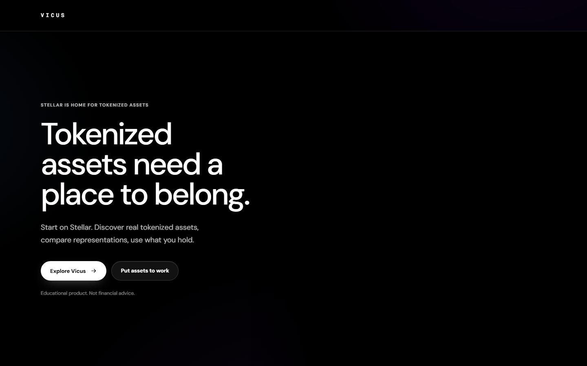](https://explorevicus.vercel.app/)

| 02 · Discover — a visual catalogue, Stellar first | 03 · Preview — tap any tile, understand before you commit |
|---|---|
| [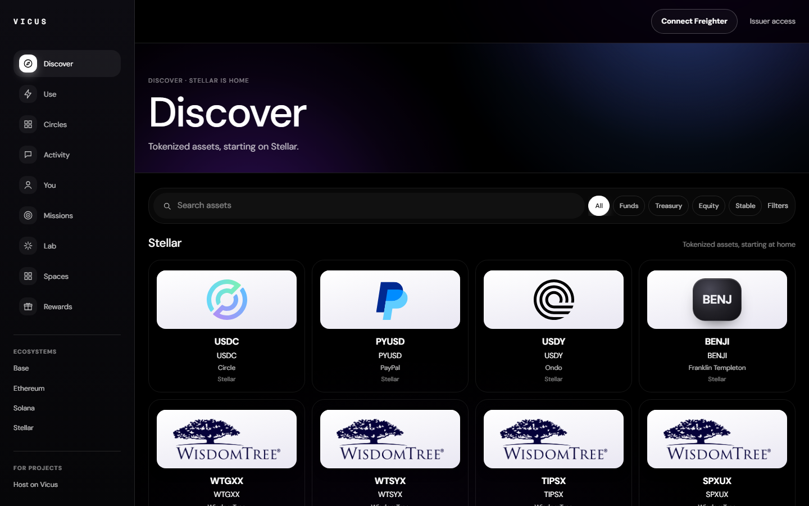](https://explorevicus.vercel.app/discover) | [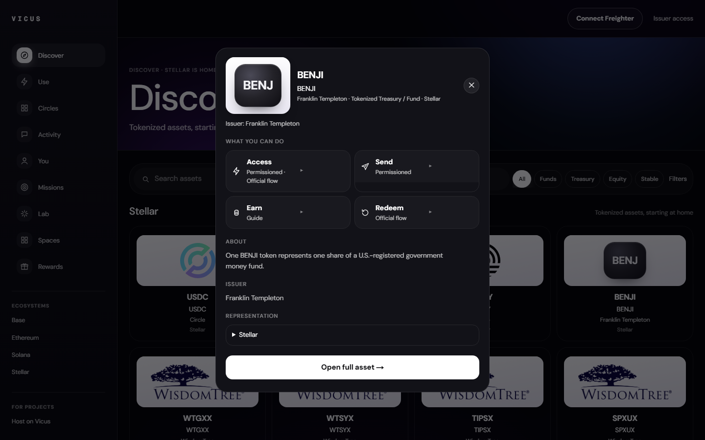](https://explorevicus.vercel.app/discover?asset=benji-on-stellar) |
| Real issuer marks (Circle, PayPal, Ondo, Franklin Templeton, WisdomTree), Stellar home layer above connected ecosystems. | BENJI's identity, available actions, short About, and a path to full detail — progressive disclosure, not a wall of text. |

| 04 · Understand — Overview with facts, not fog | 05 · Compare — Apple, honestly represented |
|---|---|
| [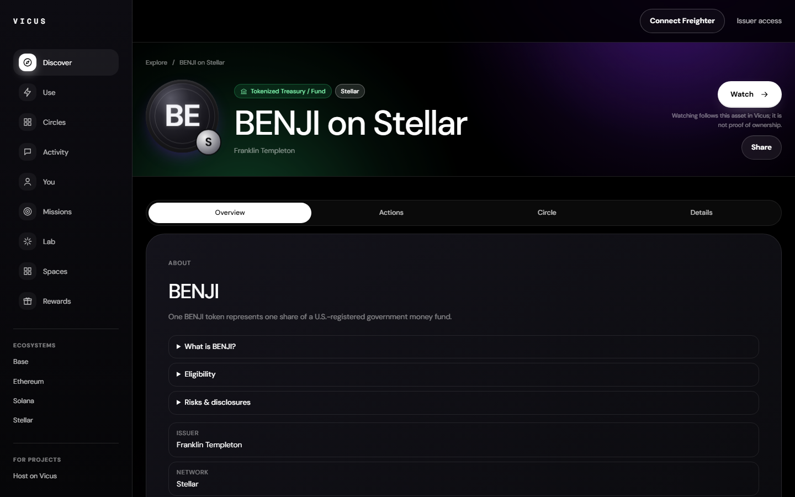](https://explorevicus.vercel.app/circles/benji-on-stellar) | [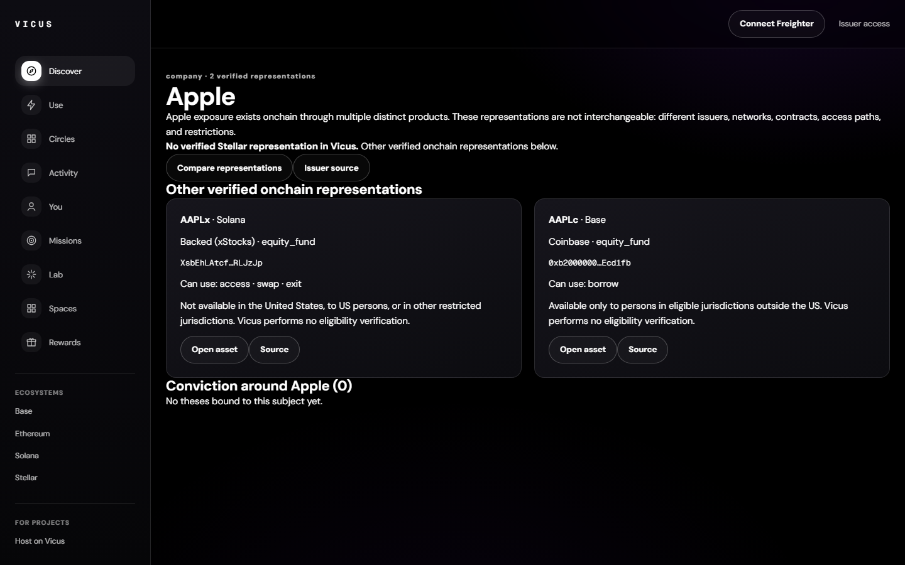](https://explorevicus.vercel.app/subjects/apple) |
| Issuer, network, asset class, lifecycle — long prose collapsed behind disclosures. | AAPLx (Solana) vs AAPLc (Base): distinct issuers, contracts, eligible actions, US restrictions — and an explicit “no verified Stellar representation.” |

| 06 · Use — action-first, not asset-first | 07 · Act — real states, real rails |
|---|---|
| [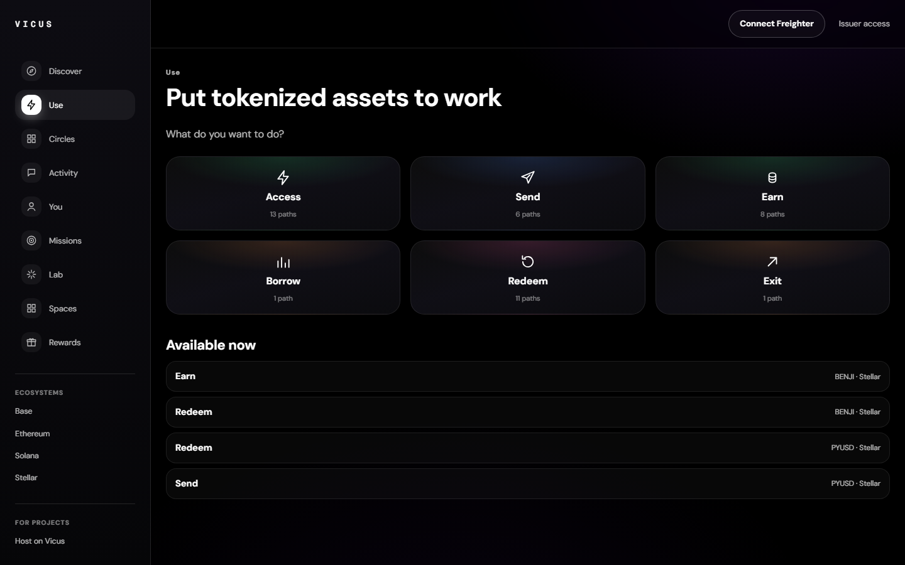](https://explorevicus.vercel.app/use) | [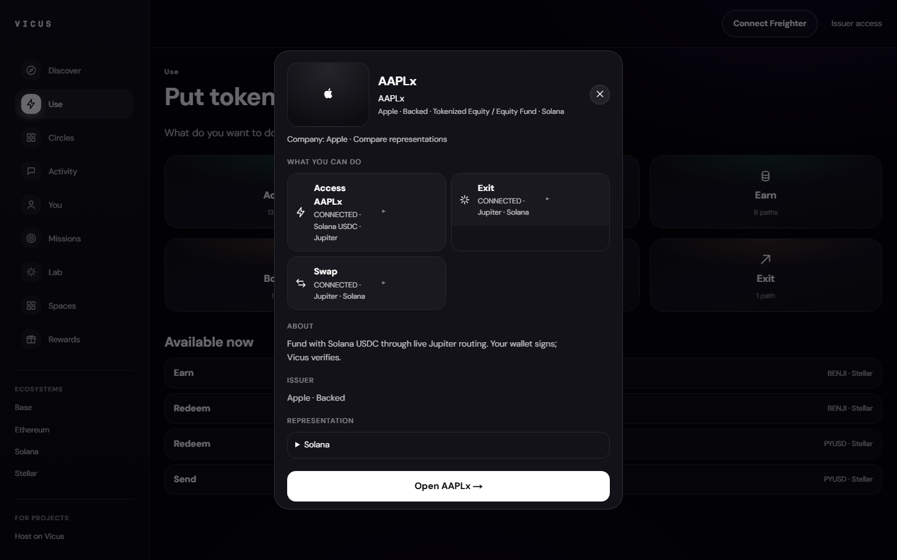](https://explorevicus.vercel.app/use?asset=aaplx-on-solana) |
| Pick what you want to do (Access, Send, Earn, Borrow, Redeem, Exit); eligible assets follow, ordered by live eligibility evidence. | AAPLx shows CONNECTED Access/Exit/Swap via Solana USDC and Jupiter routing — wallet-signed, Vicus-verified, never presented as completed. |

| 08 · Circles — people around assets | 09 · Projects — Spaces with honest metrics |
|---|---|
| [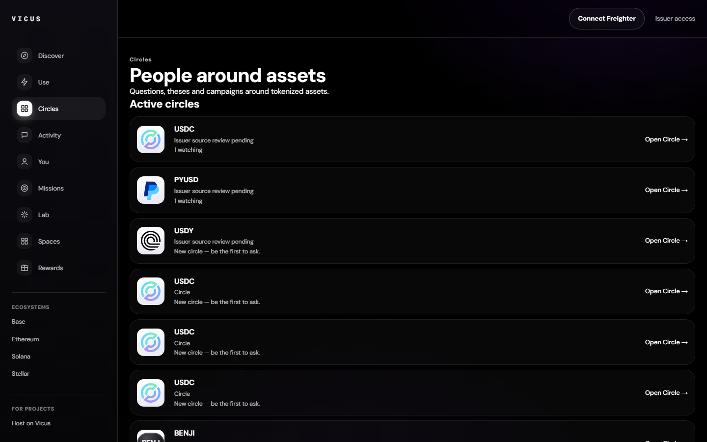](https://explorevicus.vercel.app/circles) | [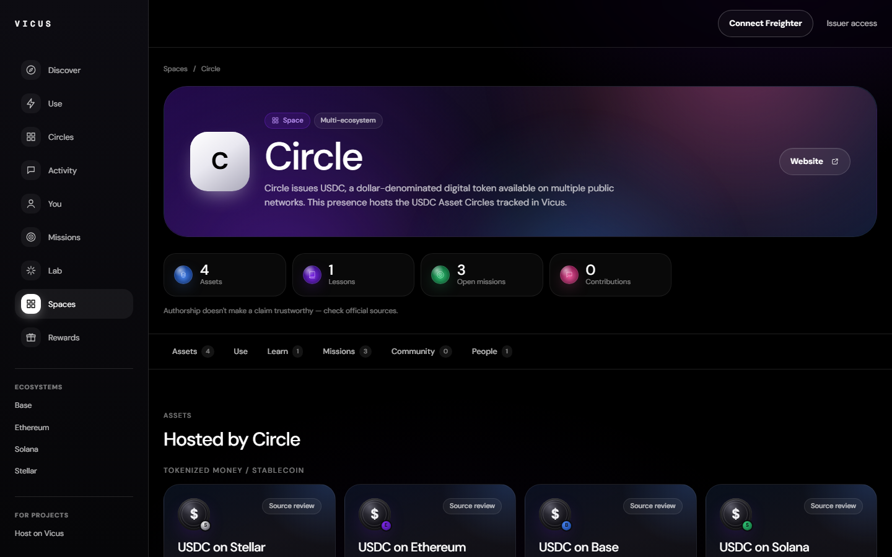](https://explorevicus.vercel.app/spaces/circle) |
| Real social signals per asset (“1 watching”) and truthful empty states where nothing exists yet. | Hosted assets, lessons, open missions — including a visible “0 contributions” where true. |

| Mobile: the catalogue in your pocket | Mobile: onboarding + verified price |
|---|---|
| 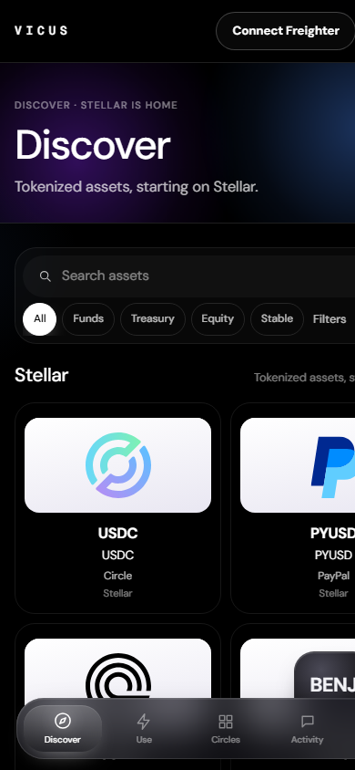 | [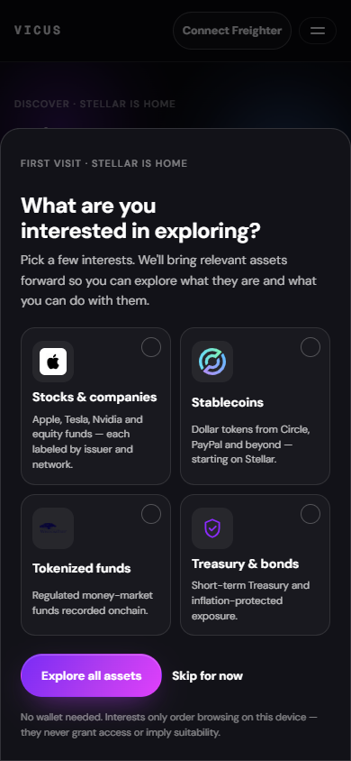](https://explorevicus.vercel.app/discover) |
| Two-column visual grid, compact filters, bottom nav — no clipping. | Four interest cards map to real registry categories; adaptive CTA; Skip and Escape always available. |

| Mobile: verified price in the preview sheet | Mobile: baskets, loyalty + reputation + roles + circles |
|---|---|
| [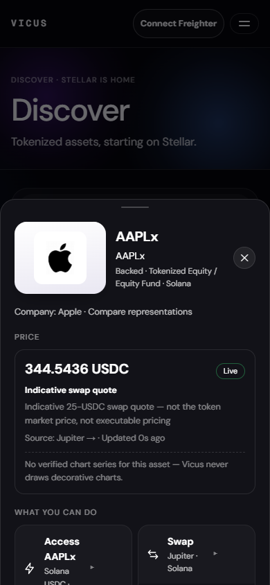](https://explorevicus.vercel.app/discover?asset=aaplx-on-solana) | [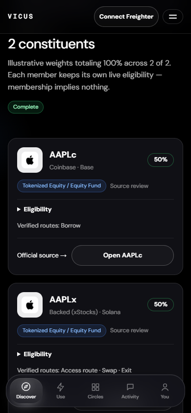](https://explorevicus.vercel.app/baskets/apple-representations) |
| Live indicative quote with source, freshness, and updated time — or an explicit no-feed state. | Brand-mark cards with weights and eligibility disclosures; [loyalty](https://explorevicus.vercel.app/profile/demo) derives only from approved missions, [reputation](https://explorevicus.vercel.app/profile/demo) separates verified contributions from authored content, and [circle roles](https://explorevicus.vercel.app/circles/usdc-on-stellar) keep holder detail private. |

| Circles directory with interest ordering | Host onboarding + asset registration |
|---|---|
| [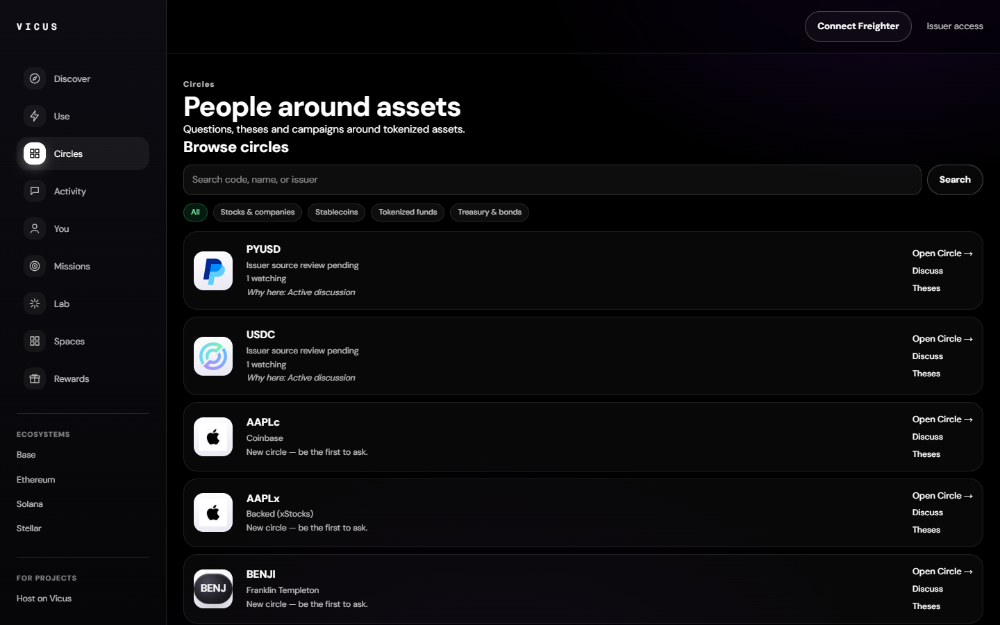](https://explorevicus.vercel.app/circles) | [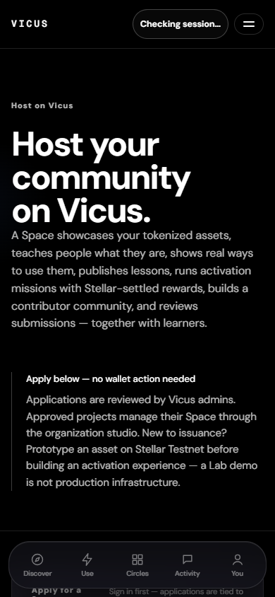](https://explorevicus.vercel.app/host) |
| Search, interest chips, per-circle Discuss/Theses/Use actions, and Why-here reasons on every card. | Staged issuer application with savable drafts and transparent review — approval creates the organization, nothing more. [Asset registration](https://explorevicus.vercel.app/host#asset-registration) validates canonical identifiers + sources with admin-only review; registered rows carry `Studio-registered (issuer unverified)` — never official. |

> Every screenshot is a production frame — see [`docs/screenshots/CAPTURE_MANIFEST.md`](docs/screenshots/CAPTURE_MANIFEST.md) for URLs and capture conditions. Prefer video? [Watch the official demo](https://youtu.be/w-jVztqD7qU).

## Proof on Stellar

### Real Testnet reward settlement — confirmed on-chain

| | |
|---|---|
| Network | Stellar Testnet |
| Asset | XLM (native, no monetary value) |
| Amount | 0.1 |
| Status | **CONFIRMED** |
| Ledger | 5066878 |
| Transaction | `36798e6e184e1c031236d47940dbf6e894447bce260cb918c8c1a2e6985b78fc` |

[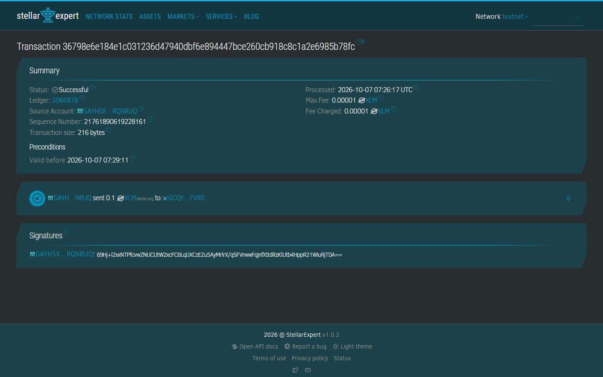](https://stellar.expert/explorer/testnet/tx/36798e6e184e1c031236d47940dbf6e894447bce260cb918c8c1a2e6985b78fc)

**[Verify on Stellar Testnet →](https://stellar.expert/explorer/testnet/tx/36798e6e184e1c031236d47940dbf6e894447bce260cb918c8c1a2e6985b78fc)** · [Raw Horizon record →](https://horizon-testnet.stellar.org/transactions/36798e6e184e1c031236d47940dbf6e894447bce260cb918c8c1a2e6985b78fc)

A user completed an eligible approved mission, claimed the reward, and Vicus settled native XLM through Stellar Testnet with a durable receipt. The on-chain record was independently re-verified: `successful: true`, one `payment` operation of `0.1000000` native XLM, ledger `5066878` — matching the stored claim exactly. Testnet XLM has no monetary value. **This historical proof does not mean public-network rewards are currently enabled** — mainnet stays behind its safety flag.

## Why Stellar?

| Integration | True state |
|---|---|
| Stellar-first discovery | **Shipped.** Home layer ordering, Stellar asset identities, issuer context. |
| Horizon role verification | **Shipped.** Mainnet trustline/holder checks returning a privacy-safe role — never a balance. |
| Freighter signed-message auth | **Shipped.** Challenge/response wallet sessions; login submits no transaction and needs no XLM. |
| Native Stellar Send | **Implemented, policy-gated.** Per-asset allowlist with sender/recipient issuer-authorization checks; permissioned assets (e.g. BENJI) fail closed. Wallet required; Mainnet end-to-end awaiting witnessed run. |
| Tokenization Lab | **Shipped, Testnet-only.** Define/trust/issue/verify flows against Stellar Testnet Horizon by construction. |
| XLM reward settlement | **Implemented, Testnet-only, funding-gated — with one independently verified historical settlement** (see [Proof on Stellar](#proof-on-stellar)). Server distributor + durable receipts; needs a funded distributor account; mainnet behind an explicit flag (off by default). |
| CCTP cross-chain send | **Implemented, restricted.** Testnet USDC toward Base/Ethereum receive endpoints; Mainnet off by design. |
| Solana/Jupiter routing (AAPLx/TSLAx access, AAPLx exit) | **Implemented, quote-verified.** Execution happens in-wallet; Vicus routes and verifies. AAPLc acquisition stays **gated** (no venue liquidity); NVDAc exposes **nothing executable**. No witnessed settlements yet. |
| Morpho borrow discovery (AAPLc) | **Discovery only.** Read-only market route into the external protocol flow; Vicus never executes borrowing. |
| Unified receipts, Compass, freshness-labeled holdings | **Shipped.** Canonical receipt contract, eligibility explanations with next steps, re-read holdings with stale labeling. |
| Claimable balances, Soroban vaults, Stellar-native swaps, Mainnet payouts, basket tokens | **Roadmap, not shipped.** |

## Safety and verifiability

Vicus is proof-first by construction:

- **Permissioned assets fail closed.** Unknown or denied issuer authorization can never authorize execution — verified by dedicated negative tests.
- **Wallet connection proves nothing but key control.** No holdings, approvals, or eligibility are inferred from a signature.
- **UNKNOWN never becomes AVAILABLE without evidence.** Eligibility, receipts, and holdings all preserve explicit unknown states.
- **Quotes are not settlements.** A live price only proves quotability; receipts distinguish initiated, prepared, signed, submitted, settled, failed, and unknown.
- **Source-chain success never proves destination delivery.** Cross-chain receipts keep per-leg evidence.
- **Holdings carry freshness context.** Every read is timestamped; stale reads are labeled, never silently refreshed; zero balances stay distinguishable from read failures.

These aren't slogans — they're covered by focused verifier scripts (`npm run *:verify`: abuse, loyalty, prices, asset-actions, receipts, rewards and more), including permissioned-boundary negatives, receipt lifecycle truth, and no-fabrication guards.

## Architecture

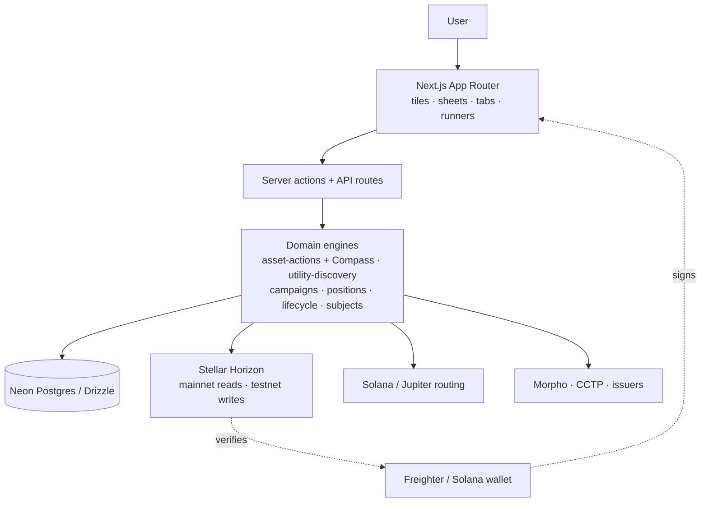

- **Frontend:** Next.js 16 App Router, React 19, Tailwind CSS 4, DM Sans / Geist Mono via `next/font`, three.js hero scene.
- **Auth and wallets:** Freighter SEP-53 signed-message sessions (HttpOnly cookies, hashed server sessions); Solana/Base execution wallets connect per-action and sign in-wallet.
- **Networks:** Stellar Mainnet reads + Testnet writes; Solana Mainnet routing; Base reads + external flows. No other chains are claimed.
- **Action Engine + Compass:** one resolver (`src/lib/asset-actions/`) maps source-backed capabilities to live execution overlays; P2 layers add eligibility verdicts, next steps, verified alternatives, and session-aware ordering — no second engine.
- **Holdings:** per-wallet chain readers (Horizon accounts, Solana token balances, Base `balanceOf`) with registry-exact matching, positive-only positions, read timestamps, and wallet isolation.
- **Transaction boundaries:** server derives amounts/assets/destinations; envelopes are exact-match verified; permissioned trustlines re-checked server-side. Vicus never holds funds or secrets.
- **Receipts:** canonical `src/lib/receipts/` contract unifies send/reward/campaign/access/swap/cross-chain records without rewriting history.
- **Persistence:** Neon Postgres via Drizzle (32 migrations); balances are never written — only receipts, sessions, quotas, and social records.

## Run locally

```bash
git clone https://github.com/kaelah971/vicus.git
cd vicus
npm install
cp .env.example .env.local   # fill DATABASE_URL (Neon); keep secrets server-side
npm run db:migrate
npm run db:seed              # demo content (optional)
npm run dev                  # http://localhost:3000
```

Useful: `npm run build`, `npm run lint`, `npx tsc --noEmit`, plus focused gates such as `npm run asset-actions:verify`, `npm run utility-discovery:verify`, `npm run positions:verify`, `npm run send:verify`, `npm run receipts:verify`, `npm run reward:verify`.

Environment names you may need (values stay yours): `DATABASE_URL`, `VICUS_APP_URL`, `VICUS_HOME_DOMAIN`, `VICUS_ADMIN_WALLET_ADDRESSES`, `VICUS_REWARD_NETWORK`, `VICUS_REWARD_DISTRIBUTOR_SECRET`, `VICUS_REWARD_MAX_XLM`, `VICUS_ENABLE_MAINNET_REWARDS` (leave off), `STELLAR_LAB_ISSUER_SECRET`. See [production-readiness](docs/production-readiness.md) for what each controls.

## Current development status

Vicus is substantially built and honestly labeled — not feature-complete. Release frame:

- **R1 — Useful + Reliable (in progress):** reliability E2E, premium experience, Compass ✅, Stellar utility research ✅, portfolio truth ✅, receipt model ✅. Outstanding: owner-witnessed financial end-to-end runs (wallets, Testnet funding, signatures).
- **R2 — Rewarding + Differentiated (planned):** baskets discovery, funded Drops, Circles reputation, Studio onboarding.
- **R3 — Infrastructure (planned):** cross-chain Routes, basket execution, vault research + ecosystem APIs.

The complete 43-milestone roadmap with statuses, evidence, and acceptance criteria lives in [docs/VICUS_MASTER_ROADMAP.md](docs/VICUS_MASTER_ROADMAP.md) (v2.26: P0.1, P1.1–P1.3, P2.1–P2.3, P3.2–P3.4, P4.1–P4.4, P5.1–P5.3, P6.1–P6.4, P7.1, P7.3, P8.1, P8.2 complete; P7.2 blocked on the holder-gated discussion lane). Current limitations: sparse-but-real community activity, one ticker-fallback brand mark (BENJI, documented in `src/lib/asset-visuals.ts`), no review-SLA policy yet (reported, not promised), no approved asset-drop providers (XLM-only in effect), reward end-to-end needs a funded Testnet distributor.

---

**Live:** [explorevicus.vercel.app](https://explorevicus.vercel.app) · Discover → Understand → Access → Hold → Use → Send → Earn → Exit.
