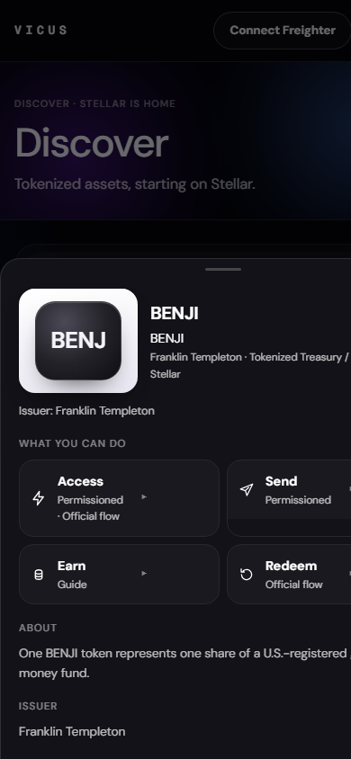
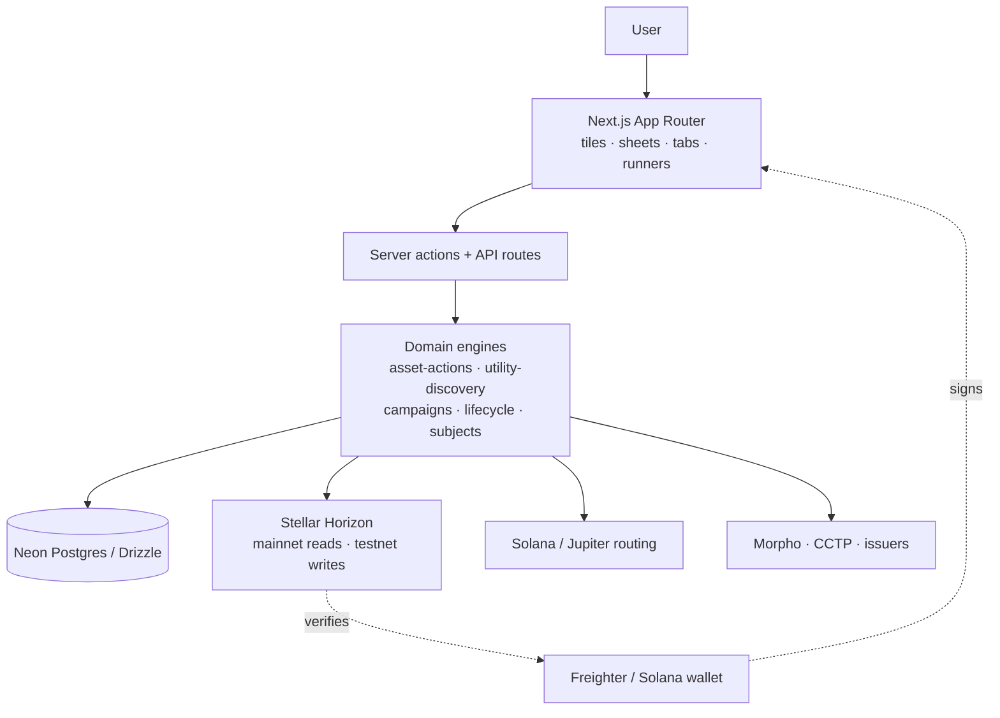

<div align="center">

# VICUS

### Where tokenized assets become usable.

A Stellar-first operating layer for discovering, understanding, accessing, and using tokenized assets.

**Discover what exists. Understand what it represents. See what you can actually do. Participate around the asset.**

[](https://explorevicus.vercel.app)
[](#product-walkthrough)
[](#proof-on-stellar)

     

Website · [Walkthrough](#product-walkthrough) · [Stellar Proof](#proof-on-stellar) · [Architecture](#architecture) · [Technical Documentation](#tech-stack)

</div>


<div align="center">

**Journey:** Discover → Understand → Access → Hold → Use → Send → Earn → Exit. Stellar is home; connected ecosystems extend discovery and utility.

</div>

> Live product, real data. Every screenshot below is a production frame — see [`docs/screenshots/CAPTURE_MANIFEST.md`](docs/screenshots/CAPTURE_MANIFEST.md) for URLs and capture conditions. USDC is infrastructure in Vicus, not its identity. No demo video URL exists yet — one will be linked here when published.

## The problem

A tokenized asset can be technically real and still practically unusable. The same company (say, Apple) appears as different products on different chains, from different issuers, with different eligibility rules — and none of the existing interfaces tell a normal person three things together: *what exists, what it is, and what I can actually do with it.* Wallets move value but don't explain. Dashboards display tokens but don't act. Communities live somewhere else entirely.

## The Vicus solution

Vicus puts discovery, understanding, action, and participation in one experience. One catalogue answers “what exists”; one preview sheet answers “what is it and what can I do”; one action layer routes each capability to its real execution path or official flow; one social layer gathers questions, theses, campaigns, and contributors per asset. Nothing is invented to fill gaps — gated stays gated, empty states stay empty.

## Product walkthrough

### 01 · Landing — the product in one screen

Full-width hero above. Stellar-first positioning, two doors in: **Explore Vicus** (browse) and **Put assets to work** (act).

| 02 · Discover — a visual catalogue, Stellar first | 03 · Preview — tap any tile, understand before you commit |
|---|---|
| [](https://explorevicus.vercel.app/discover) | [](https://explorevicus.vercel.app/discover?asset=benji-on-stellar) |
| Real issuer marks (Circle, PayPal, Ondo, Franklin Templeton, WisdomTree), Stellar home layer above connected ecosystems. | BENJI's identity, available actions, short About, and a path to full detail — progressive disclosure, not a wall of text. |

| 04 · Understand — Overview with facts, not fog | 05 · Compare — Apple, honestly represented |
|---|---|
| [](https://explorevicus.vercel.app/circles/benji-on-stellar) | [](https://explorevicus.vercel.app/subjects/apple) |
| Issuer, network, asset class, lifecycle — long prose collapsed behind disclosures. | AAPLx (Solana) vs AAPLc (Base): distinct issuers, contracts, eligible actions, US restrictions — and an explicit “no verified Stellar representation.” |

| 06 · Use — action-first, not asset-first | 07 · Act — real states, real rails |
|---|---|
| [](https://explorevicus.vercel.app/use) | [](https://explorevicus.vercel.app/use?asset=aaplx-on-solana) |
| Pick what you want to do (Access, Send, Earn, Borrow, Redeem, Exit); eligible assets follow. | AAPLx shows CONNECTED Access/Exit/Swap via Solana USDC and Jupiter routing — wallet-signed, Vicus-verified, never presented as completed. |

| 08 · Circles — people around assets | 09 · Projects — Spaces with honest metrics |
|---|---|
| [](https://explorevicus.vercel.app/circles) | [](https://explorevicus.vercel.app/spaces/circle) |
| Real social signals per asset (“1 watching”) and truthful empty states where nothing exists yet. | Hosted assets, lessons, open missions — including a visible “0 contributions” where true. |

| Mobile: the catalogue in your pocket | Mobile: the preview sheet |
|---|---|
|  |  |
| Two-column visual grid, compact filters, bottom nav — no clipping. | BENJI sheet at ~⅔ viewport over the dimmed grid, grab handle and action grid intact. |

## Judge Vicus in 90 seconds

1. **Land** on [explorevicus.vercel.app](https://explorevicus.vercel.app/) — read the proposition, note the two doors.
2. **Discover** at [`/discover`](https://explorevicus.vercel.app/discover) — filter Stellar vs beyond-Stellar, open any tile.
3. **Preview BENJI** at [`/discover?asset=benji-on-stellar`](https://explorevicus.vercel.app/discover?asset=benji-on-stellar) — check actions, About, issuer, representation.
4. **Understand** at [`/circles/benji-on-stellar`](https://explorevicus.vercel.app/circles/benji-on-stellar) — switch Overview / Actions / Circle / Details tabs.
5. **Compare Apple** at [`/subjects/apple`](https://explorevicus.vercel.app/subjects/apple) — read the restrictions, note the missing Stellar representation.
6. **Use** at [`/use`](https://explorevicus.vercel.app/use) — pick Earn, see which assets actually support it.
7. **Circles** at [`/circles`](https://explorevicus.vercel.app/circles) — verify social signals are real, empties are empty.

No wallet needed for any of the above. Wallet-gated flows stop at an explicit connect step.

## Proof on Stellar

### Real Testnet reward settlement — confirmed on-chain

| | |
|---|---|
| Network | Stellar Testnet |
| Asset | XLM (native, no monetary value) |
| Amount | 0.1 |
| Status | **CONFIRMED** |
| Ledger | 5066878 |
| Transaction | `36798e6e184e1c031236d47940dbf6e894447bce260cb918c8c1a2e6985b78fc` |

[](https://stellar.expert/explorer/testnet/tx/36798e6e184e1c031236d47940dbf6e894447bce260cb918c8c1a2e6985b78fc)

**[Verify on Stellar Testnet →](https://stellar.expert/explorer/testnet/tx/36798e6e184e1c031236d47940dbf6e894447bce260cb918c8c1a2e6985b78fc)** · [Raw Horizon record →](https://horizon-testnet.stellar.org/transactions/36798e6e184e1c031236d47940dbf6e894447bce260cb918c8c1a2e6985b78fc)

A user completed an eligible approved mission, claimed the reward, and Vicus settled native XLM through Stellar Testnet with a durable receipt. The on-chain record was independently re-verified: `successful: true`, one `payment` operation of `0.1000000` native XLM, ledger `5066878` — matching the stored claim exactly. Testnet XLM has no monetary value. **This historical proof does not mean public-network rewards are currently enabled** — mainnet stays behind its safety flag.

## Why Stellar?

| Integration | True state |
|---|---|
| Stellar-first discovery | **Shipped.** Home layer ordering, Stellar asset identities, issuer context. |
| Horizon role verification | **Shipped.** Mainnet trustline/holder checks returning a privacy-safe role — never a balance. |
| Freighter signed-message auth | **Shipped.** Challenge/response wallet sessions; login submits no transaction and needs no XLM. |
| Native Stellar Send | **Shipped, policy-gated.** Per-asset allowlist; permissioned assets (e.g. BENJI) require issuer-authorized recipients. Wallet required. |
| Tokenization Lab | **Shipped, Testnet-only.** Define/trust/issue/verify flows against Stellar Testnet Horizon by construction. |
| XLM reward settlement | **Implemented, Testnet-only, funding-gated — with one independently verified historical settlement** (see [Proof on Stellar](#proof-on-stellar)). Server distributor + durable receipts; needs a funded distributor account; mainnet behind an explicit flag (off by default). |
| CCTP cross-chain send | **Implemented, restricted.** Testnet USDC toward Base/Ethereum receive endpoints; recipient must hold an endpoint. |
| Solana/Jupiter routing (AAPLx/TSLAx access, AAPLx exit) | **Connected.** Execution happens in-wallet; Vicus routes and verifies. AAPLc acquisition stays **gated**; NVDAc exposes **nothing executable**. |
| Morpho borrow discovery (AAPLc) | **Connected discovery.** Read-only market route into the external protocol flow. |
| Claimable balances, Soroban vaults, mainnet payouts | **Roadmap, not shipped.** |

## Real functionality and boundaries

| Area | Status |
|---|---|
| Asset Action Engine (available / permissioned / connected / gated) | Shipped — single resolver, engine truth reused by Discover, Use, sheets, and verifiers |
| Campaigns, missions, manual + automatic review | Shipped, live records |
| Verified reward records | Real receipts where Testnet-funded; never mocked |
| Community posts, answers, helpful votes | Shipped; sparse where sparse |
| Conviction theses (paper + verified-position) | Shipped |
| Contacts, receive endpoints, spaces, lessons | Shipped |
| Testnet-only, permissioned, connected, and gated states | Labeled as such in-UI; this README mirrors those labels |

## Architecture



Modules map 1:1 to `src/lib/*` (access, asset-access, asset-actions, campaigns, circles-social, community, conviction, crosschain-send, lab, lending, lifecycle, rewards, send, subjects, utility-discovery, …). Wallet authorization boundaries: Vicus never holds funds or secrets; execution is wallet-signed, Vicus verifies.

## Tech stack

Next.js 16 (App Router) · React 19 · Drizzle ORM + Neon Postgres · Stellar SDK + Freighter API + Stellar Wallets Kit · Solana web3.js · Tailwind CSS 4 · DM Sans / Geist Mono via `next/font` · three.js hero scene · TypeScript + ESLint · 50+ `tsx` verifier scripts (`npm run *:verify`).

## Local setup

```bash
git clone https://github.com/kaelah971/vicus.git
cd vicus
npm install
cp .env.example .env.local   # fill DATABASE_URL (Neon); keep secrets server-side
npm run db:migrate
npm run db:seed              # demo content (optional)
npm run dev                  # http://localhost:3000
```

Useful: `npm run build`, `npm run lint`, `npx tsc --noEmit`, plus focused gates such as `npm run stellar-home:verify`, `npm run utility-discovery:verify`, `npm run asset-actions:verify`, `npm run wave3-ia:verify`.

## Verification and testing

The repo ships 50+ bounded verifier scripts covering engines, discovery ordering, action parity, representations, social integrity, lifecycle, and IA. Core UI/truth gates (stellar-home, utility-discovery, asset-circles, asset-actions, representations, lifecycle, community, conviction, wave3-ia) pass against production code; typecheck, lint, and production build are green. No test counts are claimed beyond what these scripts assert.

## Current limitations and honest next steps

- Community activity is real but sparse — empty states are shown, not backfilled.
- Two brand marks (Tesla, Franklin Templeton) use ticker fallback: official endpoints block automated fetching; documented in `src/lib/asset-visuals.ts`.
- Reward settlement needs a funded Testnet distributor to demonstrate end-to-end; mainnet stays behind its flag.
- No public demo video URL exists yet — owner to provide; no placeholder button shipped.

---

**Live:** [explorevicus.vercel.app](https://explorevicus.vercel.app) · **Stellar – Find Your Way.** Discover → Understand → Access → Hold → Use → Send → Earn → Exit.
